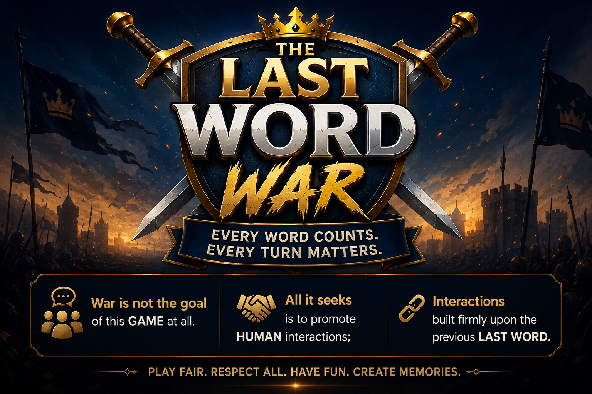

[](https://the-last-word-war.vercel.app)

# The Last Word War™

*A human-centered multiplayer experiment in conversation, learning, and collaborative creativity.*

---

## Overview

The Last Word War™ is a multiplayer conversational game in which players collaboratively build a shared dialogue by beginning each sentence with the **last word** of the previous sentence.

The project is intentionally designed around:

> **Human ↔ Human Interaction**

Technology provides the computational framework for interaction while preserving human judgment throughout gameplay.

Unlike many modern digital systems that prioritize Human ↔ AI interaction, The Last Word War™ places authentic human conversation at the center of the experience.

---

## Philosophy

> War is not the goal of this GAME at all.  
> All it seeks is to promote HUMAN interactions;  
> interactions built firmly upon the previous LAST WORD.

Artificial intelligence assists the project's development, documentation, and research.

Gameplay itself remains intentionally Human ↔ Human. Interpretation, creativity, and the culture of play belong to the players rather than the software.

---

## Quick Rules

1. Create or join a room.
2. Once a match begins, no new players may join.
3. Players take turns submitting sentences.
4. Each sentence must begin with the **last word** of the previous sentence.
5. Each submitted turn scores **+1 point**.
6. A timeout incurs a **−1 point** penalty.
7. Players who accumulate **three consecutive timeouts** are automatically removed from the match.
8. The first player to reach **10 points** triggers the **Final Round**.
9. Tied leaders enter **Sudden Death**.
10. The match ends when only one active player remains or when all remaining players become inactive.

---

## Example

**Player 1**

> Science helps us understand nature.

**Player 2**

> Nature inspires technological innovation.

**Player 3**

> Innovation drives economic growth.

---

## Features

### Gameplay

* Sentence-chain mechanics
* Automatic last-word extraction
* Automatic score tracking
* Final Round
* Sudden Death
* Tie-aware standings
* Multiplayer integrity rules
* Inactivity management

### Multiplayer

* Online room creation and joining
* Host-authoritative synchronization
* Realtime game synchronization
* Shared countdown timers
* Closed-match enforcement
* Automatic inactive-player removal
* Online rematch support
* Session persistence and recovery

### User Experience

* Welcome screen onboarding
* Quick Rules guide
* Timeout notifications
* Feedback collection
* Browser session recovery

---

## Gameplay Philosophy

The Last Word War™ intentionally preserves human judgment.

The software coordinates multiplayer interaction by managing rooms, turns, timing, synchronization, scoring, and session state.

Players remain responsible for interpreting meaning, evaluating creativity, resolving disagreements, and defining the culture of play.

> **The software defines the framework of play.**  
> **The players define the culture of play.**

---

## Current Status

**Version:** v0.1.2

**Stage:** Feature Complete Alpha

### Current Focus

* Codebase refactoring
* Component extraction
* UX refinement
* Playtest #2
* Feedback analysis
* Human-centered gameplay research
* Computational facilitation
* Publication preparation

---

## Technology Stack

| Layer | Technology |
|--------|------------|
| Frontend | React, Vite |
| Backend | Supabase, PostgreSQL |
| Realtime | Supabase Realtime |
| Deployment | Vercel |
| Version Control | Git, GitHub |

---

## Repository Structure

```text
Artwork/
Design_Documents/
Legal/
Marketing/
Papers/
Project_Archive/
Prototype/
Releases/
Research/
Rulebook/
Website/
```

---

## Documentation

Project documentation is organized into dedicated directories.

* `Design_Documents/` — Philosophy, architecture, gameplay specifications, and technical design.
* `Research/` — Development journal, playtesting, publications, and project state.
* `Releases/` — Version history and release notes.
* `Rulebook/` — Official game rules and gameplay specification.
* `Papers/` — Research manuscripts and academic publications.

---

## Research Themes

The Last Word War™ also serves as a research initiative exploring:

* Human-centered computing
* Human ↔ Human interaction systems
* Computational facilitation
* Educational gaming
* Multiplayer interaction systems
* Responsible AI-assisted development

---

## Roadmap

### Current Phase

* Component refactoring
* App.jsx simplification
* Continued codebase modularization
* Playtest #2
* Publication preparation

### Planned

* Classroom Edition
* Tournament support
* Educational modes
* Spectator mode
* Analytics dashboard
* Mobile application

---

## Stewardship

**Project Steward:** Victor A. Adeyemi

**Organization:** Da-aim Services

**Contact:** [daaim4you@gmail.com](mailto:daaim4you@gmail.com)

---

## License

License to be determined.
